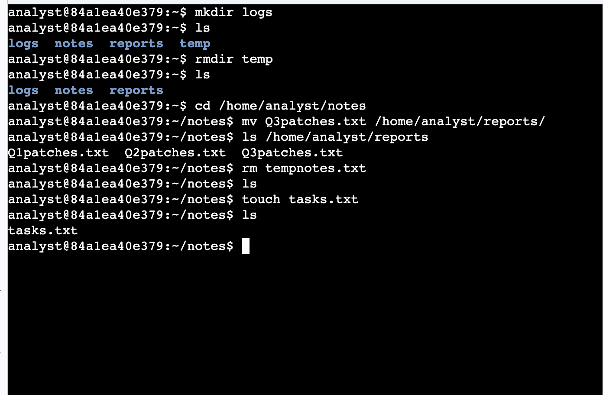
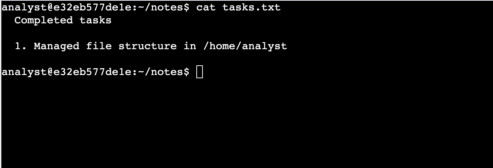

# Linux File and Directory Management

## Overview
A hands-on Linux command-line activity completed as part of the Google Cybersecurity Certificate training.

## Objective
Organize the `/home/analyst` directory by creating and removing directories, moving and deleting files, creating a new file, and documenting the changes performed.

## Tools
- Linux terminal
- Bash

## Commands Used

| Command | Purpose |
|---|---|
| `mkdir` | Create a new directory |
| `ls` | List directory contents |
| `rmdir` | Remove an empty directory |
| `cd` | Navigate between directories |
| `mv` | Move files to another directory |
| `rm` | Remove files |
| `touch` | Create a new empty file |
| `echo` | Write text into a file |

## Tasks Performed

1. Created a `logs` directory in `/home/analyst`.
2. Removed the `temp` directory.
3. Moved `Q3patches.txt` from `notes` to `reports`.
4. Deleted `tempnotes.txt`.
5. Created `tasks.txt` inside `notes`.
6. Recorded the completed tasks in `tasks.txt`.

## Skills Demonstrated
- Linux file and directory management
- Command-line navigation
- File creation, deletion, and relocation
- Basic text file modification
- Filesystem organization

## Evidence

### File and Directory Management

### Task Documentation

## Disclaimer
This activity was completed in a simulated training environment as part of the Google Cybersecurity Certificate.
