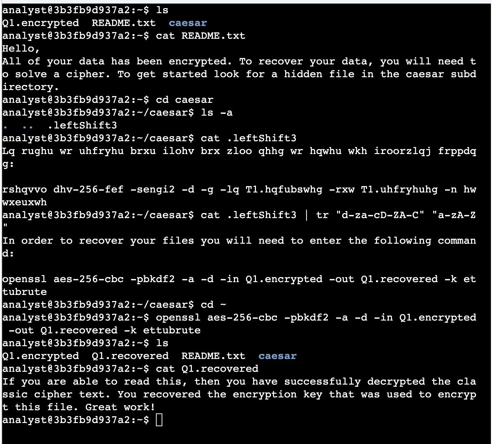

# Linux File Decryption and Caesar Cipher Analysis

## Overview

A hands-on Linux and cryptography activity completed as part of the Google Cybersecurity Certificate. The exercise involved locating a hidden file, decoding a Caesar cipher, and using the recovered passphrase to decrypt an encrypted data file.

## Objective

Use Linux command-line tools to locate hidden files, decode a substitution cipher, and recover encrypted file contents using OpenSSL.

## Tools and Commands

- **Linux Terminal** – Command-line environment used throughout the activity.
- `ls` – Lists directory contents.
- `ls -a` – Displays all files, including hidden files.
- `cd` – Navigates between directories.
- `cat` – Displays file contents.
- `tr` – Translates characters to decode the Caesar cipher.
- `openssl` – Performs file decryption.

## Tasks Performed

### 1. Explore the Home Directory

Used `ls` to identify the available files and directories, then used `cat README.txt` to read the recovery instructions.

### 2. Locate the Hidden File

Navigated into the `caesar` directory and used `ls -a` to locate the hidden file `.leftShift3`.

### 3. Decode the Caesar Cipher

Used the following command to decode the hidden instructions:

`cat .leftShift3 | tr "d-za-cD-ZA-C" "a-zA-Z"`

The command translated the encoded characters by shifting them backward by three positions, revealing the recovery instructions and passphrase.

### 4. Decrypt the Encrypted File

Used OpenSSL with AES-256-CBC and PBKDF2 to decrypt the encrypted data file and save the recovered output as `Q1.recovered`.

### 5. Verify File Recovery

Used `ls` to confirm that the recovered file existed, then `cat Q1.recovered` to verify that its contents were readable.

## Security Concepts Demonstrated

- Linux filesystem navigation
- Hidden file discovery
- Caesar cipher decoding
- Character substitution using `tr`
- AES-256-CBC file decryption
- Password-based key derivation using PBKDF2
- Encrypted data recovery

## Skills Demonstrated

- Linux command-line operations
- Basic cryptography concepts
- Cipher decoding
- OpenSSL command-line usage
- File recovery and verification
- Following technical instructions and troubleshooting

## Supporting Evidence

The screenshot below shows the Linux commands used to locate the hidden file, decode the Caesar cipher, decrypt the encrypted data, and verify successful recovery.

## Disclaimer

This activity was completed in a simulated training environment as part of the Google Cybersecurity Certificate. It demonstrates basic cryptography and Linux command-line operations, not the breaking of modern encryption.
