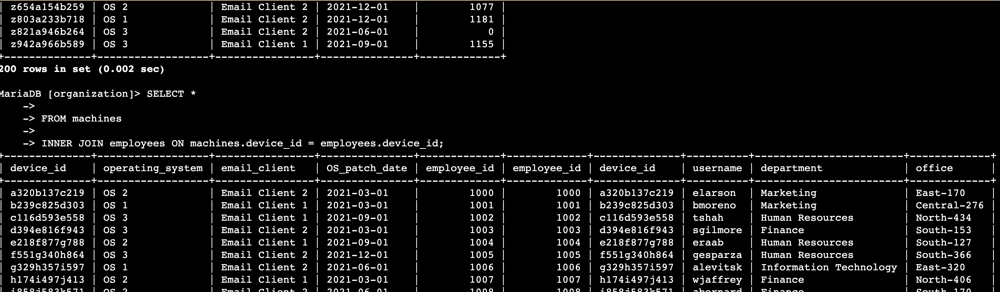
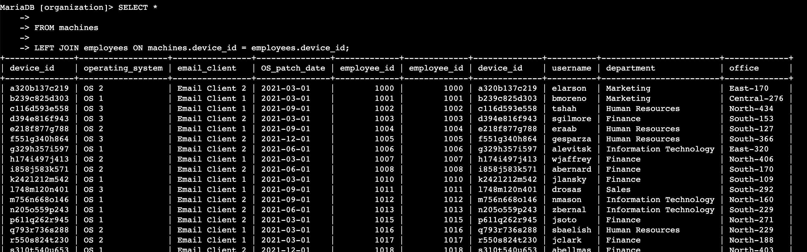
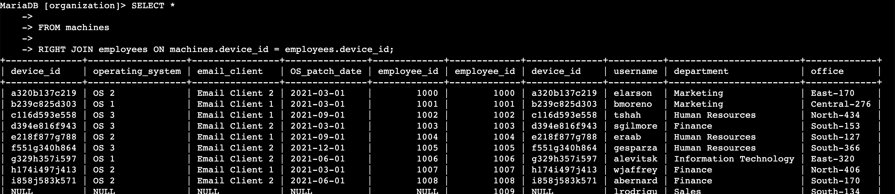

# SQL JOINs for Security Investigations

## Overview

A hands-on SQL activity completed as part of the Google Cybersecurity Certificate. This exercise involved combining employee, machine, and login attempt records to support a simulated security investigation.

## Objective

Use SQL JOIN operations to retrieve related information from multiple database tables and identify relationships between employees, assigned machines, and login activity.

## Tables Examined

- `employees` – Employee IDs, usernames, departments, office locations, and device IDs.
- `machines` – Device IDs, operating systems, email clients, and OS patch dates.
- `log_in_attempts` – Login dates, times, countries, IP addresses, and login success status.

## SQL Concepts

- `INNER JOIN`
- `LEFT JOIN`
- `RIGHT JOIN`
- `ON` clause and matching columns

## Investigation Tasks

1. Match employees with their assigned machines.
2. Identify machines without assigned employees.
3. Identify employees without assigned machines.
4. Retrieve login attempts associated with employee records.

## Skills Demonstrated

- SQL table joins
- Relational database querying
- Identifying unmatched records
- Connecting employee and machine information
- Analyzing login activity

## Evidence and Query Results

### 1. INNER JOIN – Employees and Login Attempts

Combined employee records with login attempt records using matching usernames. This query returned 200 matching records.

### 2. INNER JOIN – Machines and Employees

Matched machine records with employee records using the device ID column to identify assigned machines.

### 3. LEFT JOIN – Machines and Employees

Retrieved all machine records, including machines without a matching employee record. Unmatched employee information appears as NULL.

### 4. RIGHT JOIN – Machines and Employees

Retrieved all employee records, including employees without an assigned machine. The results included an employee record with NULL machine information.

## Disclaimer

This activity was completed in a simulated training environment as part of the Google Cybersecurity Certificate. It does not represent an actual organizational security investigation.
